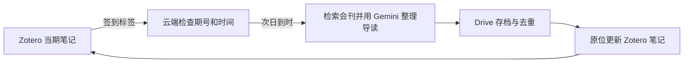

# Zotero 论文精选

一个用 Zotero 签到控制的科研论文推荐工作流。读完本期精选后给笔记加签到标签，下一天早上由 Google Apps Script 调用 Gemini 生成下一期，保存到 Drive，再更新 Zotero 里的同一条笔记。没签到时保留当前一期，后台检查不会调用模型。支持周末，电脑可以关机。



每期约 3–4 篇，包含来源、开放 PDF 链接、难度、阅读建议和可练习的推导。模型依据公开论文资料写导读，公式练习和写作点评需要对照原文。论文 PDF 由你选中后自己用 Zotero Connector 保存。

## 准备账号和工具

- 一个已启用同步的 [Zotero](https://www.zotero.org/support/sync) 个人文库，以及安装了 [Zotero Connector](https://www.zotero.org/download/) 的浏览器。
- 一个可用 [Google Drive](https://drive.google.com/) 和 [Apps Script](https://script.google.com/home) 的 Google 账号。
- 一个 [Google AI Studio](https://aistudio.google.com/projects) 的 Gemini API 项目。先在 **Projects** 确认项目是 **Free Tier** 且未关联结算，再到 **API Keys** 创建密钥。模型可用性、免费额度和数据使用以 [Gemini 定价](https://ai.google.dev/gemini-api/docs/pricing/) 和 [API 条款](https://ai.google.dev/gemini-api/terms) 为准。

下载这个仓库。可以在 GitHub 点 **Code → Download ZIP**，解压后按下面步骤操作。搭建流程不需要命令行。

## 1. 建 Drive 文件夹和两个云端脚本

1. 在 Drive 新建一个空的私人文件夹，例如 `科研论文精选`。打开文件夹，从地址栏复制 `/folders/` 后面的文件夹 ID。
2. 打开 [Apps Script](https://script.google.com/home)，点 **新建项目**，命名为 `论文精选 · 生成`。把 [engine/Code.gs](engine/Code.gs) 的内容粘贴到默认的 `代码.gs`，替换示例代码。点文件区 **＋ → 脚本**，新增 `Sources`，粘贴 [engine/Sources.gs](engine/Sources.gs)。
3. 在左侧 **齿轮 → 项目设置**，勾选 **在编辑器中显示 appsscript.json 清单文件**。回编辑器，将清单替换为 [engine/appsscript.json](engine/appsscript.json)，保存。
4. 同样新建一个 `论文精选 · Zotero 回写` 项目。粘贴 [relay/Code.gs](relay/Code.gs) 和 [relay/appsscript.json](relay/appsscript.json) 到对应文件，保存。

两项目分开授权。生成项目能读取 Zotero 签到并写 Drive，回写项目能读 Drive 并更新指定的 Zotero 笔记。脚本属性里保存的密钥可被项目编辑者访问，建议保持两个项目私有。 [Apps Script 属性设置说明](https://developers.google.com/apps-script/guides/properties#manage_script_properties_manually)

## 2. 初始化 Drive 论文库

在 **生成项目 → 项目设置 → 脚本属性** 下添加 `DRIVE_FOLDER_ID`，值填步骤 1 的文件夹 ID，保存。在编辑器顶部函数下拉框选 **`setupPaperLibrary` → 运行**，按 Google 页面核对并授予项目所需权限。

执行日志会给出 `zoteroHeading` 和 `DRIVE_TODAY_FILE_ID`。记下两项。Drive 文件夹中会出现固定的今日精选、候选、历史、归档、去重索引和选读偏好。首次是可签到的欢迎页。日后要调整主题，在 Drive 编辑「选读偏好.md」的 `优先关键词` 和 `排除关键词` 两行，例如 `- 优先关键词：Flow Matching，inverse problems`。偏好在脚本内用于排序，发送给 Gemini 的材料只包含公开论文数据和通用导读要求。

如果 Drive 只显示 Markdown 预览，下载「选读偏好.md」，用文本编辑器修改，再在 Drive 选中原文件，点 **更多 → 管理版本 → 上传新版本**。 [Drive 文件版本说明](https://support.google.com/drive/answer/2409045)

## 3. 建 Zotero 入口并创建密钥

1. 在 Zotero **我的文库**中新建「今日精选」分类，在分类里创建一条**独立笔记**。第一行粘贴上一步日志里的 `zoteroHeading`，例如 `今日精选｜2030-01-01`。第二行可写 `看完这一期后，请给本笔记加上签到标签。` 同步后从 Zotero 网页文库打开这条笔记，记下地址中的 8 位条目键 `ZOTERO_NOTE_KEY`。 [Zotero 条目键说明](https://www.zotero.org/support/dev/web_api/v3/basics#items)
2. 在 [Zotero 密钥设置](https://www.zotero.org/settings/keys) 记下纯数字 **User ID**。创建两把不同用途的密钥，群组权限都选 **None**。

   | 密钥 | 个人文库权限 |
   | --- | --- |
   | 生成项目用的只读密钥 | Allow library access、Allow notes access |
   | 回写项目用的密钥 | Allow library access、Allow notes access、Allow write access |

3. 签到标签的默认名称是 `精选：本期看过`。若要用数字 `4` 签到，按 [Zotero 配置步骤](zotero/README.md) 配置彩色标签。初次安装完成前保持这条笔记未签到，方便验证后台等待状态。 [Zotero 彩色标签说明](https://www.zotero.org/support/collections_and_tags#colored_tags)

Zotero 的写入权限按个人文库授权，回写代码会检查条目键、类型、期号及版本，只更新你配置的那条独立笔记。把个人阅读笔记记在别处，因为「今日精选」正文会被下一期替换。

## 4. 填生成项目的脚本属性

| 属性 | 填什么 |
| --- | --- |
| `DRIVE_FOLDER_ID` | 步骤 1 的文件夹 ID，初始化时已填 |
| `ZOTERO_USER_ID` | Zotero 网页上的数字 User ID |
| `ZOTERO_NOTE_KEY` | 当期独立笔记的 8 位条目键 |
| `ZOTERO_READ_KEY` | 步骤 3 创建的 Zotero 只读密钥 |
| `GEMINI_API_KEY` | 你自己的 Gemini 密钥 |
| `GEMINI_FREE_TIER_CONFIRMED` | 确认自己的 API 项目未关联结算后填 `yes` |

可选设置 `PAPER_TIME_ZONE`（默认 `Asia/Shanghai`）、`PAPER_RELEASE_TIME`（默认 `08:15`，24 小时制）、`PAPER_ACK_TAG`（默认 `精选：本期看过`）和 `GEMINI_MODEL`（默认 `gemini-3.1-flash-lite`）。更改签到标签名时，回写项目也要设同一个值。免费层标记表示你已核对账户；若后来修改计费，请先暂停生成再重新核对。

保存后，运行 **`verifyPaperGenerator`** 检查配置、云端笔记和可用论文来源。通过后运行 **`installPaperGenerator`**。到左侧 **触发器** 确认出现一个 `paperGeneratorTick`。它每隔几分钟检查一次，签到的下一自然日到时才生成。

## 5. 填回写项目的脚本属性

| 属性 | 填什么 |
| --- | --- |
| `DRIVE_TODAY_FILE_ID` | 步骤 2 日志里的固定今日精选文件 ID |
| `ZOTERO_USER_ID` | 和生成项目相同 |
| `ZOTERO_NOTE_KEY` | 和生成项目相同 |
| `ZOTERO_WRITE_KEY` | 步骤 3 创建的 Zotero 写入密钥 |
| `PAPER_ACK_TAG` | 可留空；若自定义了签到标签，两边保持一致 |

运行 **`relayStatus`**，核对 `noteDate` 与 `driveDate` 相同。欢迎页显示 `reportHasCards: false` 属正常。再运行 **`installPaperRelay`**，在触发器列表确认一个 `paperRelayTick`。两项安装都完成后，可以等一轮后台检查，在两项目的 **脚本执行** 里核对等待签到的日志。

## 6. 日常怎么用

1. 在 Zotero 打开「今日精选」。看完后选中当期笔记，按绑定的签到数字键（按本仓库步骤为 `4`），或者手动加上 `精选：本期看过`。确认 Zotero 完成数据同步。一天可以一篇都不选。
2. 次日到设定时间后，Google 云端检查会启动选题。生成、写入和 Zotero 同步需要几分钟。打开 Zotero 同步后，仍在原笔记看下一期，上一期的签到标签由回写脚本清除。
3. 想读某篇时，从简介打开官方条目，用 Zotero Connector 保存。你也可以加「待读、在读、已读」标签。普通论文的标签和收藏不会触发生成。

可选：[Zotero 阅读状态和 Markdown 学习档案插件](zotero/README.md)。保存论文 PDF 后，插件可在该论文下创建一份 Markdown 学习草稿。

## 验收与排查

| 现象 | 看哪里 |
| --- | --- |
| 当前仍是欢迎页或上一期 | 在 Zotero 网页文库核对当期独立笔记是否有签到标签，再看生成项目的「脚本执行」是否在等签到或次日时间。 |
| Zotero 读取失败 | 核对 User ID、8 位 note key、密钥权限和 Zotero 网页同步是否对应同一个个人文库。 |
| Drive 新一期已发布，Zotero 还是旧期 | 看回写项目的执行日志，核对写入密钥、同一个 note key 和固定 Drive 文件 ID。若出现版本冲突，先完成 Zotero 同步，下一次检查会重试。 |
| 某论文源返回 403 或覆盖不足 | 查看 `verifyPaperGenerator` 日志。可以在 [Sources.gs](engine/Sources.gs) 更新官方来源，候选不足时先保留上一期。 |
| Gemini 返回限额或 API 错误 | 到 AI Studio 核对模型和免费额度。排除原因后，运行 `retryPaperGeneration`，允许下一次符合条件的后台检查重试。 |
| 想暂停 | 在两项目分别运行 `pausePaperGenerator` 和 `pausePaperRelay`。恢复时重新运行对应的安装函数。 |

验收顺序是「没签到，保持旧期 → 签到，当天仍保持 → 次日开始生成 → Drive 新期出现 → Zotero 更新并清除签到」。本地模拟测试见下方。真正的云端生成时间、可用来源和账号授权要在各自实例上核验。

来源配置位于 `Sources.gs` 顶部，包含 PMLR、CVF、RSS、期刊和 OpenReview 等公开入口。部分条目固定到相应届次，后续可按会刊发布情况更新。归档集中在一个长期 Markdown 文件，接近 Apps Script 单文件写入上限时，脚本会停下，待备份并整理归档后继续。

## 开发与本地测试

使用 Node.js 18 或更新版本，在仓库根目录运行：

```sh
node --test workflow.test.cjs engine/test.cjs relay/test.cjs zotero/test.cjs
```

仓库代码可按本文下载并部署到自己的账号。请把密钥、个人论文笔记和私有文件 ID 保存在各自的私人项目中。
